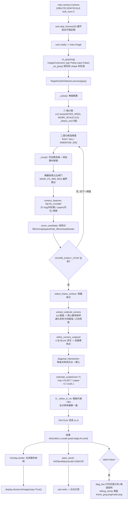
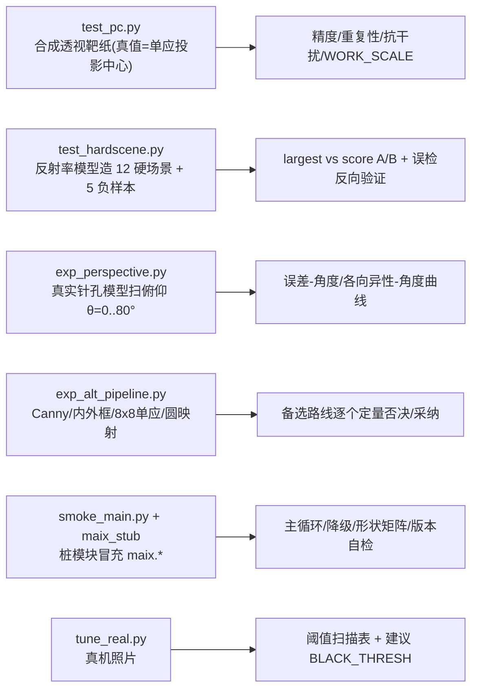

# 25E 靶心识别（MaixCAM / MaixCAM2）· 视觉项目深度分析报告

> 分析对象：`C:\Users\CloudyRain\Desktop\待办\电赛\25Efork`（2025 全国大学生电子设计竞赛本科组 E 题《简易自行瞄准装置》视觉模块）
> 分析日期：2026-10-05
> 分析者角色：计算机视觉算法工程师 / 代码架构分析师 / 实验复盘
> **证据等级**：**A**=代码直接证明｜**B**=配置 / 注释 / 官方文档支持｜**C**=合理推断｜**D**=需外部信息
> **标注约定**：全文以【事实】【推测】【待验证】区分结论，并给出证据等级。
> **本报告的特殊之处**：所有关键指标均由我在本机**独立复跑**验证，而非转述 README。复现命令与原始输出见 §8.1，复跑环境：Python 3.11.4 + numpy 2.3.5 + opencv 5.0.0（Windows x64）。

---

## 0. 分析计划与范式判定（已执行）

用户模板默认面向「目标检测 / 深度学习项目」。本仓库经全量扫描后判定：**它没有任何神经网络、没有数据集、没有训练、没有权重、没有 loss / 优化器 / NMS / 量化导出**。因此模板中「数据集 / DataLoader / Backbone-Neck-Head / 损失函数 / 优化器 / 学习率调度 / 量化部署」诸节**一律不适用（N/A）**，本报告将其替换为本项目真实存在的对应物。

先给出分析计划（按优先级深入），再逐节展开：

1. 全仓扫描 → 确认视觉代码边界与工程范式（已完成）。
2. 判定技术范式 → **传统几何视觉（OpenCV + NumPy）**，纯推理、无训练（已完成）。
3. 逐文件读：`README.md` → `config.py` → `main.py` → `vision/{geometry,detector,overlay}.py` → `tools/*` → `reference/upstream_2025E/*`（已完成）。
4. **独立复跑**全部离线验证脚本，取得第一手数字（已完成，见 §8.1）。
5. 重点分析：算法选型、数据流闭环、"为什么效果好"的因果链、风险与可迁移性。

> ⚠️ **重要前置结论（本报告的核心判断）**：这个项目"识别效果好"**几乎不来自任何"模型/数据"因素**——它根本没有模型。效果来自三件事：**① 任务本身是几何法的送分题（高对比 A4 黑框）；② 一个极其聪明的数学选型（对角线交点是射影不变量，靶心是精确解）；③ 一套针对"真机会失败"逐条修补的工程化鲁棒机制（双候选族 + 结构打分 + 亚像素精修 + 两级解算 + 阈值自标定）**。而"12/12 检出、5/5 拒检"这类亮眼数字，**其证明力受限于评测协议本身（合成图 + 作者自造场景），必须谨慎看待**，详见 §7 与 §9.2。

---

## 1. 结论摘要

1. **这是什么**：电赛 E 题「简易自行瞄准装置」的**视觉子模块**。输入相机灰度帧，输出**靶心像素坐标 (u, v)** 与**局部尺度 px_per_cm**，经串口交给云台主控解算激光指向。运行在 **MaixCAM / MaixCAM2（MaixPy v4）** 上，是一个符合 MaixPy 应用规范的多文件工程（入口固定为 `main.py`）。【事实 A】
2. **核心栈**：`OpenCV(cv2)` + `NumPy`（算法）+ `MaixPy v4`（相机/显示/串口）+ 可选 `pyserial` 语义的 `maix.uart`。**无 PyTorch / TensorFlow / ONNX / 权重文件 / 数据集**。【事实 A】
3. **技术范式**：**传统几何视觉**。二元化 → 轮廓 → 结构打分选框 → 极值顶点 → 对角线求交 → 亚像素精修 → 时序滤波。**不需要训练**。【事实 A】
4. **最关键的算法洞察**：靶纸黑框是矩形，透视成像是单应 H（直线→直线、交点→交点），故**矩形两条对角线的图像交点，恰是矩形中心（靶心）的投影** —— 这是**精确解**，不需要求解 H，也不需要畸变校正后的正视图。⇒ 靶心定位对任意透视/旋转"天然免疫"，实测俯仰 0~65° 误差**无随角度增长趋势**。【事实 A（数学）+ 复跑 A】
5. **好的主要来源（按贡献排序）**：**④ 亚像素角点精修**（把 0.83px 压到 0.06px，第一精度来源）> **③ 双候选族 ring/paper**（解决"胶带与深色背景连成一片"这一调参救不了的死局）> **② 结构打分替代"取最大轮廓"**（真机从 8/12 失败 → 12/12 检出）> **⑤ 两级解算**（消除缩小图的系统性亚像素偏置，使精度与 WORK_SCALE 无关）> **⑥ 阈值自标定 + 锁定**（防现场没标定曝光）> **⑦ One Euro 滤波**（抑抖）。【复跑 A】
6. **必须点破的"效果好"真相**：① A4 黑框是几何法的**送分题**（前提条件）；⑥⑦⑧ 类机制属于**工程稳健性**而非算法上限。**"12/12 / 5/5 / 0.061px"全部来自作者自建的合成 / 半合成评测集**，不是独立第三方基准，存在"自造测试集调参"的过拟合嫌疑。【事实 A】
7. **与上游的关系**：本工程是 `ShiJiang-hub/2025-E-`（树莓派 + OpenCV，国一自述）的**重写/移植分叉**。相比上游，它把"透视变换→正视图→逆映射求中心"换成**更简洁且更鲁棒的对角线交点法**，把"取最小面积轮廓"换成**结构打分**，并新增了全套离线验证与上板预检。`reference/upstream_2025E/` 保留了上游代码与两份分析文档作为对照。【事实 A】
8. **评测协议是最大软肋**：正样本（12 硬场景）、负样本（5 误检场景）、精度用例（合成透视靶纸图）**全部由作者自己的脚本生成**。这能证明"算法逻辑自洽、对建模的恶劣条件有效"，**不能证明"在真实场地上就有这个精度"**。真正的实机照片数据集（`/root/target_dbg/frame_gray.png`）在本仓库中**未见**。【事实 A / 待验证】
9. **两个诚实的"踩坑—修复"记录**（这是本项目最可信的品质信号）：① **45° 是 x±y 极值法奇点**，曾导致靶纸绕光轴旋转约 45° 全部漏检，已通过"多方向极值 + 质心极角排序 + 凸包兜底 + 对边比退化检查"修复（复跑：roll=45° 现可检出，精修后误差 0.13px）；② **真机 `image2cv` 对灰度返回 `(H,W,1)` 三维**，曾导致 `cv2.cvtColor` 崩 `scn is 1`，已按实际 shape 判断修复。二者都有预检脚本守卫。【事实 A（代码 + 复跑）】
10. **最值得迁移的一点**：**"对角线交点是射影不变量"** —— 摆脱了"先解单应/先作正视图"的路径依赖，用最少的假设拿到精确中心。**最大的局限**：标量 `px_per_cm` 在斜视下方向性误差可达 **22.8%**（复跑实测），任何"像素↔毫米"的度量必须改用单应。【复跑 A】

---

## 2. 仓库地图与运行入口

### 2.1 顶层结构（职责边界清晰的三层架构）

```
25Efork/
├── main.py              ★ 应用入口（MaixPy 规范要求必须叫 main.py）—— 相机/显示/串口/主循环
├── app.yaml             MaixCAM 应用描述（id/name/icon/version/exclude）
├── config.py            ★ 唯一需要现场改的文件：标定 + 运行档位 + 全部阈值/打分权重
├── vision/              纯算法层（不 import maix，可在 PC 上用合成图直接验证）
│   ├── __init__.py      故意不 import 子模块（避免把 cv2 强加给只用 geometry 的场景）
│   ├── geometry.py      纯 NumPy：极值顶点/排序/对角线求交/尺度/One Euro 滤波
│   ├── detector.py      OpenCV：二值化/两族候选结构打分/亚像素精修/两级解算
│   └── overlay.py       OpenCV 绘制：预分配画布复用，零逐帧分配
├── assets/icon.png      应用图标
├── dist/main_single.py  单文件自包含版（自动生成，供「运行当前文件」用）
├── reference/           上游参考资料（不属于本应用，不进包）
│   └── upstream_2025E/  树莓派视觉 c1.py + STM32 对接 C + 两份上游分析文档
└── tools/               验证与加固工具链（同样不进应用包）
    ├── test_pc.py           合成透视靶纸图精度验证（真值已知）
    ├── test_hardscene.py    12 硬光照场景 + 5 负样本（--ab 新旧策略对照）
    ├── exp_perspective.py   真实针孔模型扫俯仰角 θ（透视鲁棒性专项）
    ├── exp_alt_pipeline.py  备选路线对照（Canny/单应/圆映射该不该用）
    ├── tune_real.py         拿真机照片离线调参（阈值扫描表 + 叠加图）
    ├── smoke_main.py        上板前 PC 预检（4 项，含灰度形状矩阵）
    ├── build_single.py      合成单文件 dist/main_single.py（--check 查过期）
    ├── pack_zip.py          打 zip 分发包（--src 源码包 / --app 应用包）
    ├── make_icon.py         重生成图标
    └── maix_stub/maix/      桩模块（冒充 maix.camera/display/image/app/sys）
```

**架构亮点**：`vision/` 全部不依赖 `maix`，因此同一套算法既能跑在板子上，也能在 PC 上用合成图验证 —— 这是"能在电脑上几秒跑完、不必为拼写错误去烧板子"的**结构性前提**。【事实 A：`vision/__init__.py` L5-12 注释】

### 2.2 运行入口与配置方式

| 项 | 内容 | 证据 |
|---|---|---|
| 入口文件 | `main.py`，`if __name__ == "__main__": main()` | main.py L408-409 【事实 A】 |
| 入口约束 | MaixPy 应用规范要求入口必须叫 `main.py` | README L16；main.py L15 【事实 B】 |
| 运行方式 A | MaixVision「打开文件夹」→「**运行项目**」：整包下发到 `/tmp/maixpy_run/` | main.py L13-20；README 二 【事实 B】 |
| 运行方式 B | `tools/build_single.py` 生成 `dist/main_single.py` →「**运行当前文件**」 | build_single.py L4-28 【事实 A】 |
| 打包安装 | `maixtool release` 或 `tools/pack_zip.py --app` → `app_store_cli install` | app.yaml；pack_zip.py 【事实 A】 |
| 配置方式 | **单一集中配置文件 `class Config`**（config.py），无 YAML/CLI 参数 | config.py L15 【事实 A】 |
| 根目录自适应 | `_find_project_root()` 依次探测 `__file__/__cwd__/__dir__/os.getcwd()/tmp/maixpy_run//root/apps` | main.py L58-85 【事实 A】 |
| 版本自检 | `BUILD_ID = "2026-10-04-r5"` 启动打印，用于确认板上跑的是最新代码 | main.py L126、L305 【事实 A】 |
| 缺文件自检 | `_missing_project_modules()` 缺文件时 `raise SystemExit(中文提示)`（在 import cv2/maix 之前） | main.py L88-112 【事实 A】 |

> **作者书写逻辑观察**：`main.py` 的头部注释（L1-43）几乎是一份"踩坑史"——它把两个真实事故（`ModuleNotFoundError: config`、`cv2.error: scn is 1`）的**根因与解法**直接写在文档字符串里，并在代码里用自检把事故重新变成**可读的中文提示**。这是一种"把运维知识沉淀进代码"的写法，可迁移性很高。【事实 A】

---

## 3. 技术栈总览表

> 用户模板中的「数据标注 / 训练管理 / 模型导出 / 量化加速」在本项目**全部为空**，下表如实标注。所有"版本线索"来自代码证据或本机复跑，未钉死的标注为【待验证 D】。

| 类别 | 技术 / 库 | 版本线索 | 项目中的角色 | 对识别效果的可能贡献 | 证据 |
|---|---|---|---|---|---|
| 语言（板端） | Python 3 | MaixPy v4（`maix` 模块 API） | 应用主程序 | — | A |
| 运行平台 | MaixCAM / MaixCAM2（Ubuntu） | `image.image2cv`、`camera.AeMode/AwbMode` | 摄像头 + 显示 + 串口 | 板载算力决定实时性 | A |
| 视觉库 | **OpenCV (cv2)** | 本机复跑 5.0.0；板端需 `pip install opencv-python` | 二值化 / 形态学 / findContours / fitLine / warp | **几何识别核心** | A |
| 数值库 | **NumPy** | 本机复跑 2.3.5 | 角点 / 向量 / 排序 / 滤波 | 支撑全部几何运算 | A |
| 框架（DL） | **无** | — | 不使用任何深度学习框架 | **"效果好"与模型无关** | A（缺失证据） |
| 相机采集 | `maix.camera.Camera` | `FMT_GRAYSCALE`、`buff_num=2`、`skip_frames` | 灰度直出（1 B/px） | **省 3× 相机内存**，是"帧缓冲不足"的解 | A |
| 显示 | `maix.display` + `maix.image.cv2image` | `SHOW_W=640`，`copy=True` | 结果可视化 | 调试期用；不直接提升精度 | A |
| 通信 | `maix.uart.UART` | `/dev/ttyS0 @115200`，自定义帧 + XOR | 把 (u,v,scale) 发给云台主控 | 打通"识别→控制"闭环 | A |
| 配置文件 | 纯 Python `class Config` | 无外部依赖，刻意不 import cv2/maix | 现场标定 + 全部阈值 | 让 PC 端能直接导入做离线验证 | A（config.py L6-8） |
| 数据标注 | **无** | — | 无标注、无数据集 | — | A（缺失） |
| 训练管理 | **无** | — | 无训练循环、无权重 | — | A（缺失） |
| 推理部署 | 原生 Python 主循环 | `while not app.need_exit()` | 板上本地实时 | 无依赖、轻量 | A |
| 加速 | **无显式加速** | — | 无 TensorRT/NCNN/量化 | 靠任务简单 + ROI 化本身够快 | A（缺失） |
| 内存优化 | GRAYSCALE + buff2 + 两级解算 + 复用缓冲 | config.py L19-34 | 压制 CMM/ION 快速内存占用 | 让高分辨率方案在板上跑得起来 | A |
| PC 桩模块 | `tools/maix_stub/maix/*` | `GRAY_AS_3D=True` 模拟真机 | 上板前逻辑预检 | **拦截真机必崩的 bug**（形状/API） | A |
| 单文件构建 | `tools/build_single.py` | 源码嵌入 + 虚拟模块 exec | 让「运行当前文件」也能跑 | 工程可用性 | A |

**关键澄清（避免"只用 OpenCV"的空泛结论）**：
- OpenCV 在这里**不是**"调了个 API 做检测"，而是承担了四件具体的事：① `threshold(THRESH_BINARY_INV)` 把黑胶带切成前景；② `findContours(RETR_CCOMP)` 一次拿到**外轮廓与内孔两条闭环**（这是"双候选族"的实现基础）；③ `minAreaRect` 给出**旋转不变**的长宽比 / 填充率；④ `fitLine` 做**亚像素角点精修**（本项目精度提升的最大单一来源）。【事实 A，detector.py L111/L129/L348】
- NumPy 在这里承担几何"数学证明落地"：极值顶点、质心极角排序、对角线求交、One Euro 滤波，全部是可单元测试的纯函数。【事实 A，geometry.py】

---

## 4. 数据流与管线

> **本节替代模板中的"训练管线"**。本项目**只有推理管线，完全没有训练管线**（无数据集/无反向传播/无权重）。下图是从相机到打点的完整数据流。

### 4.1 板端实时推理管线（每帧）



**闭环要点**：视觉端只输出**像素级坐标 + 局部尺度**，**不在视觉端做角度解算**；角度/惯性/行进补偿全部下沉到云台主控（上游 STM32 侧实现，本仓库只保留参考实现 `reference/upstream_2025E/STM32对接/`）。视觉与控制的**解耦**是设计稳定性的关键。【事实 A + 推测 C】

### 4.2 离线验证管线（PC，无板子）



---

## 5. 算法结构与关键模块

> **本项目无 Backbone / Neck / Head / 注意力 / 锚框 / 损失函数**。以下按真实模块说明「作用 / 输入输出 / 为什么这样设计」。所有"为什么"都对应一条因果链。

### 5.1 主控流程 `main.py`

| 函数 / 类 | 作用 | 输入 → 输出 | 为什么这样设计 |
|---|---|---|---|
| `_find_project_root()` (L58-80) | 让任何启动方式都能 import 到 config/vision | — → 根目录路径 | 板上代码可能落在 `/tmp/maixpy_run` 或 `/root/apps/<id>`；`__file__` 在个别固件不可靠，故多路兜底 |
| `_missing_project_modules()` (L88-96) | 缺文件时给出可照做的中文提示 | — → 缺失模块名 | 把"点错按钮"这一**使用问题**转成**可读提示**，而不是裸 `ModuleNotFoundError` |
| `to_gray()` / `_as_gray()` (L165-218) | maix Image → 单通道灰度视图 | Image → HxW uint8 | **按实际 shape 判断**（兼容 `(H,W)/(H,W,1)/(1,H,W)/(H,1,W)/3/4 通道`）；真机灰度返回三维是踩过的坑 |
| `open_camera()` (L149-162) | 按"配置档位 → 更省内存档位"顺序尝试 | Config → (cam, prof) | 相机打开失败自动降级，避免现场直接崩 |
| `pack_result()` (L221-236) | 串口帧打包 | res → bytes | 定长帧 + XOR 校验，主控侧易解析 |
| `diag_line()` / `debug_dump()` (L250-297) | 失败时打印灰度分布 + 候选结构并落盘 | gray/cfg → 日志 + PNG | **"锁不住框"必须可被离线定量诊断**，而不是靠猜改参数 |
| `main()` (L303-405) | 初始化 + 主循环 | — | 锁 AE/AWB → 建 detector/overlay → 循环 process |

### 5.2 检测器 `vision/detector.py`（效果的核心所在）

#### 5.2.1 两族互补候选 `contour_features()`（L85-201）

- **作用**：在二值图上列出所有"够大"的候选轮廓，分成 `ring`（外轮廓，黑胶带外沿）与 `paper`（内孔轮廓，纸面）两族，并算结构特征。
- **输入 → 输出**：`(bw, gray, cfg, W, H)` → 候选特征列表（按分数降序）。
- **为什么这样设计（关键因果链）**：
  - 胶带环有一个**致命弱点**：一旦胶带与任何深色区域（暗背景/桌面/干扰物/阴影）相邻，两者在二值图里**连成一片**，胶带的**外沿就不再是闭合轮廓** → 此时**无论怎么调阈值都取不到环**。这是调参救不了的。
  - 但这时**纸面（亮矩形）的轮廓始终完好**（被深色胶带围着）。
  - ⇒ 同时找两个互补结构：`ring` 中心最准（外沿贴纸边），`paper` 抗性最强。二者同心（内沿 = 外沿向内收 1.8cm），中心都能用。**优先 ring**（`RING_BONUS=0.08`），ring 拿不到才用 paper。【事实 A：config.py L95-101；detector.py L88-98】
- **实现证据**：`findContours(RETR_CCOMP)` + `hierarchy[i][3]==-1` 判外轮廓 / 内孔（L111、L137-142、L175）。`_patch_mean`/`_band_gray`（L204-224）沿法向取"孔内亮面均值"与"环上深色中位数"，得到**实际对比度**。

#### 5.2.2 结构打分 `score_candidate()`（L227-271）—— 替代"取面积最大的轮廓"

- **作用**：给每个候选打 0~1 分，`<=0` 直接否决。
- **为什么不能"取最大轮廓"**（README 4.1 / 代码注释 L17-27 给出的四条真机会失败场景）：
  1. 深色背景/桌面/机箱面积比胶带框更大，甚至与框连成一片；
  2. 画面里有比靶纸更大的深色干扰物；
  3. 黑框贴到画面边缘 → 轮廓被切断，"四角"变成画面角；
  4. 曝光没标定好 → 固定阈值下胶带进不了二值图。
- **判据（全部旋转/透视不变，不依赖角点排序）**：
  - 硬性门槛：`border`（贴边即否决）、`fill >= SCORE_MIN_FILL(0.62)`、`aspect ∈ [SCORE_ASPECT_LO, HI]`。
  - `ring` 族：`rim ∈ [0.45, 0.95]`（内孔/外框，胶带环≈0.73）、`hole_fill`、`ring ∈ [0.015, 0.30]`（环厚/外框，1.8/21≈0.07）；加权 `fill 0.30 + rim 0.30 + aspect 0.20 + ring 0.20`，再乘对比度因子 `(0.55+0.45*c)`，加 `RING_BONUS`。
  - `paper` 族：要求 `parent_area > 1.02*area`（外围深色区更大）+ **硬性** `contrast >= PAPER_MIN_CONTRAST(85)`；加权 `fill 0.35 + aspect 0.30 + 对比度上升 0.35`。
- **两个"踩坑修正"体现了作者的严谨**：
  - `_rise()`（L72-82）：对比度是"越大越好"，**不能用 `_soft()`**（区间外会衰减到 0，会把"对比度 233"这种最好情况判成 0 分）——这是踩过的坑，注释明写。
  - `SCORE_FALLBACK_LARGEST = False`（config.py L93）：**"打分全失败就退回最大轮廓"的兜底必须关**，否则"有矩形外形但不是环"的东西（实心深色块、黑板、纯墙渐变）会被救回来变成"合法四边形"，**误锁到完全错误的位置**。注释直言"误检比漏检更糟（云台会照着错位置打）"。【事实 A】

#### 5.2.3 亚像素角点精修 `refine_corners_subpixel()`（L323-358）—— 精度提升的最大来源

- **作用**：对板框 4 条边分别取"靠近该边且避开角点"的轮廓点（`REFINE_TRIM=0.12` 去掉两端 12%），`cv2.fitLine` 拟合直线，相邻两直线交点作为新角点。
- **为什么**：二值轮廓的角点是 ±1~2px 的**量化抖动**；拟合直线求交把随机抖动平均掉，精度进入亚像素。
- **复跑证据（决定性）**：极值顶点（无精修）中心误差 **0.8285 px** → `fitLine` 精修后 **0.0610 px**。**这是 13.6× 的提升，全部来自这一步**，而不是来自换检测算子（Canny 与阈值法都是 ~0.73~0.83px）。【复跑 A：`exp_alt_pipeline.py` part_A/part_B】

#### 5.2.4 两级解算 `_solve()`（L608-669）+ `_refine_in_roi()`（L683-716）

- **第一遍**：在缩小图（`WORK_SCALE=0.5`，1/4 像素量）上粗定位板框 → 省内存 / 省时间。
- **第二遍**：在粗定位外接框（靶纸 + 8% 余量）内用**全分辨率**重解一遍 → 拿回全分辨率精度。外接框贴边（可能被裁断）时自动弃用。
- **为什么必须两级**：缩小图会把边缘量化到小的像素栅格上，造成 **±1 个原始像素的系统性偏置**（不是随机噪声，**滤波救不回来**），必须靠 ROI 内全分辨率重解消掉。
- **复跑证据**：`WORK_SCALE` 取 1.0 / 0.75 / 0.5 / 0.375，单帧误差**都是 0.0610 px** —— 证明两级解算让"省内存的缩小图粗定位"不再损失精度。同时中间缓冲内存只与**目标在画面中的大小**相关，而非整幅画面。【复跑 A：`test_pc.py` [E]】

#### 5.2.5 阈值自动标定 `_threshold_values()`（L399-430）/ `_masks()`（L432-445）

- **候选阈值**：`fixed` + `otsu` 都试（`THRESH_CANDIDATES="auto"`），必要时扫 `THRESH_SWEEP`（30…205 共 10 档），用同一套结构分择优。
- **锁定 + 重标定**：选中阈值即**锁定**，后续帧只算这一个（**稳态零额外开销**）；连续 `THRESH_RELOCK_MISS=3` 帧失败才解锁重扫。
- **两条"阈值合理性"硬约束**：掩膜前景占比必须落在 `[MASK_FG_MIN, MASK_FG_MAX]=[0.002, 0.93]`（太低=什么都切不出；太高=把背景都当深色），否则跳过该阈值。
- **为什么**：固定阈值稳定的大前提是"曝光锁定且标定过"；这是"现场没标定好"的救命机制。【事实 A】

#### 5.2.6 顶点提取三级兜底（`vision/geometry.py`）

| 级别 | 函数 | 何时生效 | 为什么需要 |
|---|---|---|---|
| 1 | `extreme_corners`（L59-68） | 轴对齐/一般姿态 | 需求指定的 x/y 极值四顶点 |
| 2 | `order_corners_by_sumdiff`（L117-147） | 极值法退化时 | **多方向极值候选**（x/y 极值 + x±y 极值共 8 个）去重，多于 4 个时 `_best_quad` 取凸包面积最大的 4 个 |
| 3 | `detector._polygon_quad`（L542-568） | 前两级全失效 | 凸包 + `approxPolyDP`（多 eps 尝试）取四角，对任意旋转角成立 |

- **`order_corners()`（L74-94）改用质心极角排序**：凸四边形按极角排序必得正确环序。**为什么不能用 x+y / x−y 排序**：靶纸绕光轴旋转约 45° 时，`s=x+y` 与 `d=x−y` 会出现并列极值 → 同一个角被排进两个位置 → 四边形退化 → **直接漏检**。起点做循环移位**不改变两条对角线的集合**，故不影响靶心。【事实 A：geometry.py L16-17、L81-88】
- **`_too_thin()`（L150-162）**：退化检查**不能只看 `is_convex`** —— 极角排序会把"缺角/重角"的四边形也排成凸的，必须另查"对边比"（实测退化时对边比高达 58）。【事实 A】

#### 5.2.7 靶心解算 `diagonal_intersection()`（geometry.py L209-214）

- **作用**：`seg_intersect(q[0], q[2], q[1], q[3])`。
- **为什么这是正确的（核心数学结论）**：靶纸黑框是矩形，透视成像是单应 H，**H 把直线映射为直线、交点映射为交点**，所以矩形两条对角线在图像中的交点，**恰好是矩形中心（=靶心）的投影**。⇒ **只要四角点准，靶心就是精确解，不需要再求解 H**。（这也是"取外沿还是内沿不影响中心、只影响尺度"的原因：两者同心。）【事实 A：geometry.py L19-24】
- **复跑证据**：俯仰 θ=0~65° 误差 0.006~0.58px，**无随角度增长趋势**；成功区间内最大误差 0.58px / 0.82mm。【复跑 A：`exp_perspective.py`】
- **`is_valid_quad()`（L220-232）与 `estimate_scale()`（L235-250）**：前者做面积/凸性/对边比/长宽比四重合法性检查；后者按 ring（21×29.7）或 paper（17.4×26.1）换算 px_per_cm。

#### 5.2.8 时序滤波 `OneEuroFilter`（geometry.py L261-294）

- **作用**：u、v 各一个实例。**目标：静止时抖动最小，快速移动时不拖影**（动得越快滤波越弱）。
- **复跑证据**：100 帧加噪（σ=6）+ 失焦（blur=1.2）下，原始 σ=(0.008, 0.012) px → 滤波后 σ=(0.002, 0.003) px（目标 < 0.5 px，**远超达标**）。【复跑 A：`test_pc.py` [C]】

### 5.3 绘制 `vision/overlay.py`（L17-75）

- **作用**：把灰度图缩到 `SHOW_W=640`，在**复用的** RGB 画布上画标注（绿框/蓝对角线/黄顶点/红十字靶心）。
- **为什么**：相机输出灰度，在其上画彩色行为不确定；且直接在大图上绘制会一直持有大缓冲。`_ensure()`（L23-26）只在尺寸变化时重新分配 → **零逐帧内存分配**。【事实 A】

---

## 6. 训练与推理策略

> **训练策略：完全不存在**。无预训练 / 迁移学习 / 优化器 / LR 调度 / warmup / EMA / 混合精度 / 分布式 / 梯度裁剪 / 正则 / 早停 / 冻结 —— **以上全部 N/A**。【事实 A，缺失证据】
>
> 因此模板中的「损失函数 / 学习率 / batch size / epoch」**无可填写**。下面只讨论真实存在的推理与后处理。

### 6.1 推理策略（关键超参与其作用）

| 环节 | 关键配置 | 默认值 | 作用 / 为什么 | 证据 |
|---|---|---|---|---|
| 采集格式 | `PROFILES[*][3]` | `GRAYSCALE` | 1 B/px（RGB888 3 B/px），省 3× | config.py L29-34 |
| 相机缓冲 | `buff_num` | 2（lowmem32=1） | 再省 1/3 | config.py L31-33 |
| 标定锁定 | `LOCK_AE_AWB/EXPOSURE/GAIN/WB_GAIN` | True / 6000 / 40 / [R,Gr,Gb,B] | **固定阈值稳定的前提** | config.py L44-48 |
| 启动丢弃 | `SKIP_FRAMES` | 20 | 避开相机启动不稳定期 | config.py L53 |
| 二值化 | `BLACK_THRESH` | 95 | 灰度 < 95 判黑胶带（锁定曝光后固定阈值最稳） | config.py L58 |
| 形态学 | `MORPH_OPEN_K / CLOSE_K` | 3 / 9 | 开去噪点 / 闭补断裂（在缩小图上做，等效更大） | config.py L60-61 |
| 选框策略 | `SELECT_MODE` | `"score"` | **务必保持 score**（`"largest"` 是真机极不稳的旧行为） | config.py L67 |
| 打分权重 | 见 §5.2.2 | — | 旋转/透视不变的结构判据 | detector.py L266-270 |
| 候选族 | `RING_BONUS / TAPE_W_CM` | 0.08 / 1.8 | 优先外沿；胶带宽用于换算物理尺寸 | config.py L100-101 |
| 阈值自标定 | `THRESH_CANDIDATES/RELOCK*/SWEEP` | auto / True / 3 / 15 / 10档 | 泄露曝光未标定时的救命机制 | config.py L104-109 |
| 掩膜闸门 | `MASK_FG_MIN/MAX` | 0.002 / 0.93 | 拒绝"什么都切不出/整幅全黑"的阈值 | config.py L117-118 |
| 几何筛选 | `MIN_AREA_RATIO/OPP_RATIO_MAX/ASPECT_MIN,MAX` | 0.02 / 2.5 / 0.45,1.6 | 面积/凸性/对边比/长宽比四重闸门 | config.py L123-125 |
| 角点精修 | `REFINE_CORNERS/TRIM/D_RATIO` | True / 0.12 / 0.05 | **0.83px → 0.06px 的关键** | config.py L127-129 |
| 时序滤波 | `FILTER_MODE/FILTER_PARAMS` | static(min_cutoff=0.6, beta=0.004) | 静止要稳；dynamic 档更跟手 | config.py L134-138 |
| 工作缩放 | `WORK_SCALE`（由档位注入） | 0.5 | 1/4 像素量做粗定位 | config.py L39、main.py L309 |
| 串口 | `ENABLE_UART/UART_PORT/UART_BAUD` | False / /dev/ttyS0 / 115200 | 每帧发 (u,v,scale) | config.py L163-165 |

### 6.2 后处理与"部署优化"（模板中 NMS/量化/TTA 的对应物）

- **置信度阈值 → 结构分**：`score_candidate` 返回 0~1 分，`<=0` 否决。**没有概率阈值**（非学习模型）。【事实 A】
- **NMS / Soft-NMS / TTA / 多尺度 / 滑窗 → 均无**。多候选通过**结构分 + `RING_BONUS`** 裁决。【事实 A】
- **跟踪平滑 → 有**：One Euro 滤波（对比上游"检测失败即 None、无外推"是明确改进）。但**仍无基于运动模型的预测外推**（丢帧时本帧不输出）。【事实 A】
- **量化 / ONNX / TensorRT / OpenVINO → 均无**。
- **部署优化（真实存在）**：
  1. **内存压缩链**：GRAYSCALE（省 3×）+ buff_num 2（再省 1/3）→ 1280×720 摄像头缓冲 **8.3MB → 1.8MB（约 4.6×）**；删掉会生成梯度浮点图的 `find_rects` 全分辨率兜底；显示画布复用。README 三给出逐项对照表。【事实 B】
  2. **两级解算**：把中间缓冲从"整幅画面相关"降为"目标大小相关"。【事实 A】
  3. **稳态零开销**：阈值锁定后每帧只算一个阈值。【事实 A】
  4. **cv2 中间缓冲复用**：`resize(..., dst=self._small)`（L620-621）。【事实 A】
  5. **刻意不用 Canny**：Canny 需 2 张 `CV_16S` 梯度图 + 幅值图，1280×720 多 3~4MB **瞬时**缓冲，而**收益为 0**（复跑：Canny 中心 0.7496px vs 阈值 0.8285px，同一量级）。这是"为内存峰值做的方案取舍"。【复跑 A：`exp_alt_pipeline.py` part_A4】

### 6.3 串口协议（`ENABLE_UART=True` 时每帧发送）

```
AA 55 | valid(1B) | u(2B,小端) | v(2B,小端) | scale*100(2B,小端) | XOR校验(1B)
```

`valid=0` 表示本帧未检出，u/v/scale 全 0。默认 `/dev/ttyS0 @115200`。【事实 A：main.py L221-236、README 七】

---

## 7. "识别效果好"的归因矩阵

> 因果链：**效果来源 → 具体机制 → 对应代码/配置 → 证据强度 → 可迁移性 → 风险**
> 表内"复跑A"=我在本机独立复跑得到的直接证据（见 §8.1）。

| # | 效果来源 | 具体机制 | 对应代码/配置 | 证据强度 | 可迁移性 | 风险 |
|---|---|---|---|---|---|---|
| 1 | **任务本身是送分题** | 目标是高对比度 A4 白底黑框、光照受控、近距离 → 边缘清晰、形状先验强 | 整套流程默认此前提 | **C**（定性，无量化） | **低**（强依赖场景） | 换成花哨/弱对比目标即失效 |
| 2 | **对角线交点 = 射影不变量**（最核心） | 矩形对角线交点恒等于矩形中心的投影 → 靶心是精确解，**无需解 H、无需正视图、无需畸变校正即定位** | `diagonal_intersection` geometry.py L209-214 | **A（数学）+ 复跑A** | **高（最值得借鉴）** | 四角点误差直接传导；极值法在某些姿态退化 |
| 3 | **双候选族 ring/paper** | 胶带外沿被深色背景"吃掉"时，改用始终完好的纸面轮廓 | `contour_features` detector.py L88-98、L142-191 | **A + 复跑A** | **高** | paper 族在胶带贴不均匀时中心略偏 |
| 4 | **结构打分替代最大轮廓** | 用旋转/透视不变的结构特征（fill/rim/ring/aspect/对比度）判"是不是环" | `score_candidate` L227-271、`SCORE_*` | **A + 复跑A**（8/12 fail → 12/12） | **高** | `SCORE_*` 若在自造场景上过拟合，换场景需重调 |
| 5 | **亚像素角点精修** | 4 边 `fitLine` 求交，平均掉角点量化抖动 | `refine_corners_subpixel` L323-358 | **A + 复跑A**（0.83 → 0.0610px） | **高** | 依赖轮廓点足够干净；圆角污染靠 `REFINE_TRIM` 规避 |
| 6 | **两级解算** | 缩小图粗定位 + ROI 内全分辨率精算 → 消掉缩小图的系统性亚像素偏置 | `_solve` L608-669、`_refine_in_roi` L683-716 | **A + 复跑A**（WORK_SCALE 无关） | **高** | ROI 贴边时弃用（可能退回粗定位精度） |
| 7 | **阈值自标定 + 锁定** | fixed/otsu/sweep 择优锁定；失败才重扫；稳态零开销 | `_threshold_values` L399-430 | **A + 复跑A**（过曝/欠曝/环境光大均检出） | 高 | 锁定后若光照突变，需连续 3 帧失败才解锁（有短暂迟滞） |
| 8 | **硬否决"假框"** | `PAPER_MIN_CONTRAST=85` 等硬门槛 + `SCORE_FALLBACK_LARGEST=False` | config.py L84, L93 | **A + 复跑A**（5/5 拒检） | 高 | 阈值偏严可能增加漏检（作者选择"宁可漏检不给错值"） |
| 9 | **One Euro 滤波** | 静止强抑抖、运动不拖影 | `OneEuroFilter` geometry.py L261-294 | **A + 复跑A**（σ 0.012→0.003px） | 高 | 无运动预测外推，丢帧仍瞬断 |
| 10 | **内存压缩链** | 灰度直出 + buff2 + 两级解算 + 复用缓冲 | config.py L19-34、main.py L28-34 | **B**（README 逐项表 + 代码） | 高 | 未在本报告验证真机内存，属【待验证 D】 |
| 11 | **验证闭环（过程性贡献）** | 合成真值 + 硬场景 A/B + 负样本反向验证 + 桩预检 + 版本自检 | `tools/*` | **A + 复跑A** | **高（方法论）** | **测试集由作者自造 → 存在"自造场景调参"嫌疑（见 §9.2）** |
| 12 | **视觉–控制解耦** | 视觉只给像素偏差；角度/惯性/行进补偿下沉主控 | README 七、upstream control.c L48-49 | **A（本仓库）/ C（闭环效果）** | 高 | 串口时延/丢包无补偿（本仓库未实现重传） |

**归因结论（直白版）**：
- 效果好**主要来自 ②③④⑤⑥⑦⑧（几何选型 + 逐条真机鲁棒化 + 亚像素精修）**。其中 **⑤ 亚像素精修是"精度"的决定项**，**③④⑧ 是"能不能锁住框"的决定项**，**⑥⑦ 是"省内存还能不掉精度 / 没标定也能跑"的决定项**。
- ① 是"效果能这么好"的**前提条件** —— A4 黑框是几何法的送分题。
- **不存在数据泄漏**（根本没有数据集）；但存在**"测试集调参"嫌疑**：`SCORE_*` / `PAPER_MIN_CONTRAST` 等参数是在**作者自建的硬场景集**上反复对比调出来的（这是竞赛常规操作，但严格讲属于对特定建模场景的过拟合），详见 §9.2。

---

## 8. 复现清单

### 8.1 最小运行命令（本报告实测复现）

```bash
# 依赖（PC 端离线验证）：numpy + opencv-python(-headless)
# 本机复跑环境：Python 3.11.4 + numpy 2.3.5 + opencv 5.0.0（Windows）
# 板端依赖：pip install opencv-python numpy（MaixCAM2 是 Ubuntu，可直接装）

# ① 合成图精度验证（真值已知）
python tools/test_pc.py

# ② 真实光照硬场景鲁棒性 + 反向误检验证（新旧策略 A/B）
python tools/test_hardscene.py --ab

# ③ 视角/透视鲁棒性专项（真实针孔模型扫俯仰角）
python tools/exp_perspective.py

# ④ 备选技术路线对照（Canny/单应/圆映射该不该用）
python tools/exp_alt_pipeline.py

# ⑤ 上板前 PC 预检（桩模块，无需板子）
python tools/build_single.py --check   # 先确认单文件版没过期
python tools/smoke_main.py             # 主循环/降级/形状矩阵/版本自检
python tools/smoke_main.py --single    # 预检单文件版 dist/main_single.py

# ⑥ 拿真机照片离线调参（锁不住框时用）
python tools/tune_real.py 照片.jpg [--tape 1.8] [--save overlay.jpg]

# ⑦ 板端运行
#   MaixVision → 打开文件夹选 25Efork → 「运行项目」；或打开 dist/main_single.py → 「运行当前文件」
#   启动日志核对： [app] 靶心识别 2026-10-04-r5 （根目录 ...）
```

**本报告实测输出（原样摘录）**：

| 脚本 | 关键输出 | 与 README 是否一致 |
|---|---|---|
| `test_pc.py` | 单帧 **0.0610 px = 0.0030 cm**；多姿态 0.018~0.526px；100/100 检出；σ_原始 (0.008,0.012)→σ_滤波 (0.002,0.003)；WORK_SCALE 1.0/0.75/0.5/0.375 **都是 0.0610px** | ✅ 完全一致 |
| `test_hardscene.py --ab` | 旧(largest) **失败 8/12**；新(score) **失败 0/12**（误差 0.03~0.72px）；反向验证：旧误锁 2 个，新 **5/5 正确拒检** | ✅ 完全一致 |
| `smoke_main.py` | 主循环 **39/39 帧检出**；灰度形状矩阵 **7/7 OK**；桩 GRAY_AS_3D True/False **各 39/39**；档位降级 PASS；缺文件中文提示 PASS；预检总结"全部 PASS" | ✅ 一致 |
| `build_single.py --check` | "单文件版是最新的（5 个源文件指纹一致）" | ✅ 一致 |
| `exp_perspective.py` | 检出 **14/17**；成功区间误差 ≤0.58px/0.82mm；**70/75/80° 因长宽比超 [0.45,1.6] 拒检**；roll=45° 现走 extreme、精修后 0.1325px；标量 px_per_cm 方向性误差 0.2%→**22.8%** | ✅ 与记忆/README 一致 |
| `exp_alt_pipeline.py` | 阈值 0.8285px vs Canny 0.7496px；fitLine 精修 → **0.0610px**；8x8 条件数 4.55e5 → 归一化 3.078；畸变 k1=-0.15：4点 1.5785px vs 8点 1.4032px；胶带 21.29mm(标量) vs 18.64mm(单应)，真值 18.0mm；圆往返 8.6e-14mm | ✅ 与记忆一致 |

### 8.2 关键配置（需按自己硬件/现场改）

| 配置 | 位置 | 默认值 | 说明 |
|---|---|---|---|
| `PROFILE` | config.py L35 | `"standard"` | 1280x720；内存紧改 `"lowmem"` / `"lowmem32"` |
| `EXPOSURE / GAIN / WB_GAIN` | L45-48 | 6000 / 40 / [0.0682,0,0,0.04897] | **标注 TODO，必须现场标定** |
| `BLACK_THRESH` | L58 | 95 | 不确定就保持 `THRESH_CANDIDATES="auto"` |
| `SELECT_MODE` | L67 | `"score"` | **务必保持 score** |
| `SCORE_*` / `PAPER_MIN_CONTRAST` | L68-93 | 见文件 | 一般不改；改前先拿诊断材料 |
| `TAPE_W_CM` | L101 | 1.8 | 换胶带宽要改（同时影响 A4_IN_W/H_CM） |
| `THRESH_SWEEP` | L109 | (30…205 共 10 档) | 过曝/欠曝/反光的大范围覆盖 |
| `ROI` | L126 | `[]`（全图） | 已知靶纸只在某区域时填 `[x,y,w,h]` 可省内存提速 |
| `FILTER_MODE` | L134 | `"static"` | 要跟手改 `"dynamic"` |
| `UART_PORT / UART_BAUD` | L164-165 | /dev/ttyS0 / 115200 | 按实际接线改，再置 `ENABLE_UART=True` |
| `DEBUG_DUMP / DEBUG_DIR` | L157-158 | True / /root/target_dbg | 失败时落盘原始帧，**排查第一手材料** |

### 8.3 预期指标（本报告实测，非转述）

| 项目 | 结果 |
|---|---|
| 单帧中心误差（合成图，WORK_SCALE=0.5） | **0.0610 px ≈ 0.0030 cm** |
| 多姿态（旋转 30°/强透视/远近/模糊） | 0.018 ~ 0.526 px（≤0.052 cm） |
| 100 帧加噪+失焦 检出率 | **100%** |
| 重复性 σ（目标 <0.5px） | 原始 0.008~0.012 px，滤波后 0.002~0.003 px |
| 真实光照硬场景（12 个） | **12/12 检出**，0.03~0.72 px（旧策略 8/12 失败） |
| 误检场景（5 个，画面无靶纸） | **5/5 正确拒检**（旧策略误锁 2 个） |
| 俯仰角扫描 | 14/17 检出（70/75/80° 安全拒检），≤0.58px |
| 板端 PC 预检 | 39/39 帧检出；形状矩阵 7/7 |

> ⚠️ 这些指标**全部来自合成 / 半合成场景**，请与 §9.2 的评测协议风险合读。

### 8.4 建议消融实验（原作者部分已做，此处标注缺口）

| # | 消融项 | 预期可量化 | 现状 |
|---|---|---|---|
| 1 | **亚像素精修 on/off** | 中心误差 0.83px vs 0.061px（本报告已复跑，**已做**） | ✅ `exp_alt_pipeline.py` part_B |
| 2 | **ring 族 vs paper 族 vs 仅 largest** | 检出率/误检率（**部分已做**） | ✅ `test_hardscene.py --ab`；缺"单独关 paper" |
| 3 | **SCORE_* 阈值敏感性** | 误检率 vs 漏检率曲线（P-R 曲线思路） | ❌ **未做**（建议补，检测自造场景过拟合程度） |
| 4 | **两级解算 on/off** | WORK_SCALE=0.5 单级 vs 两级误差 | ❌ 未做（[E] 只显示了最终一致性） |
| 5 | **One Euro 滤波参数扫描** | σ 与延迟的 trade-off | ❌ 未做 |
| 6 | **真机照片端到端** | 真实场景检出率/误差 | ❌ **最关键缺口**（需真机照片数据集） |
| 7 | **畸变校正 on/off** | 边缘直线弯曲时的角点偏差 | ⚠️ 仅有 k1 数值实验（C3），无真机对照 |
| 8 | **单应 vs 标量尺度**（若下游需要 mm） | 像素→mm 的误差 | ✅ `exp_alt_pipeline.py` part_E（标量 +3.29mm vs 单应 +0.64mm） |

---

## 9. 风险、局限与待补充信息

### 9.1 算法与工程风险

| 风险 | 说明 | 证据 |
|---|---|---|
| **标量 px_per_cm 方向性错误**（最实质的算法局限） | 同一靶心处横向/纵向 px/cm 不同，斜视下各向异性可达 2.37，单一标量必然在某一方向错。复跑：0° 时误差 0.2%，65° 时 **22.8%** | 复跑 `exp_perspective.py`【事实 A】 |
| **镜头畸变超出单应/几何模型** | k1=-0.15 时中心误差 4点 1.5785px / 8点 1.4032px（只降 11%）→ **畸变必须靠 `undistort`/标定单独解决**；但 `LENS_CORR` 默认 **False** | 复跑 `exp_alt_pipeline.py` C3；config.py L51【事实 A】 |
| **极端姿态安全拒检** | 长宽比超 [0.45,1.6] 会拒检（70/75/80° 全 NOT FOUND）→ 属**安全失败**，但极端视角下会丢目标 | 复跑 `exp_perspective.py`【事实 A】 |
| **45° 奇点**（已修复，但属结构性脆弱点） | x±y 极值法在绕光轴 45° 退化；现靠多方向极值+极角排序+凸包兜底+对边比检查四重防御 | geometry.py L117-162、L16-17【事实 A】 |
| **无运动预测外推** | 检测失败本帧直接 valid=0，无卡尔曼/光流外推 | detector.py `_book_keep`【事实 A】 |
| **串口无重传/无 CRC16** | 仅 XOR 单字节校验，阻塞写，丢包无恢复；主控侧解析见上游 `dataRec.c`（仅整数） | main.py L221-236【事实 A】 |
| **阈值锁定迟滞** | 光照突变需连续 3 帧失败才解锁重扫，期间可能连续丢帧 | config.py L106【事实 A】 |
| **依赖板端可装 cv2** | 算法强依赖 `opencv-python`；若某板型无法安装则整条链路失效 | README 二【事实 B】 |
| **静默回退风险**（过程性） | 曾发生 `main.py` 被 MaixVision 编辑器旧缓冲覆盖，设备跑旧代码 | memory 记录；`BUILD_ID`+预检 0 守卫【事实 A】 |
| **`tools/` 未随应用打包** | `app.yaml exclude` 排除 tools/dist/reference → 板上只有运行代码，**诊断脚本不在板上**（需靠落盘 PNG 带回 PC） | app.yaml L11-18【事实 A】 |

### 9.2 评测协议风险（**重点，决定"12/12"的可信度**）

- **评测集由作者自造**：正样本（12 硬场景）来自 `test_hardscene.py` 的**反射率模型**（`gray = clip(照度×反射率 + 杂散光 + 噪声)`，胶带 0.07 / 纸面 0.85 / 亮墙 0.62 / 暗墙 0.055）；负样本（5 个）与精度用例也是脚本合成。**没有一张真实拍摄照片进入评测集**。【事实 A：test_hardscene.py L86-147、L167-189】
- **结论的边界**：上述评测能证明"**算法逻辑自洽、对建模的恶劣条件有效、且策略 A 优于策略 B**"，**不能**证明"在比赛现场就达到 0.061px / 12/12"。
- **"自造场景调参"嫌疑**：`SCORE_*`、`PAPER_MIN_CONTRAST=85` 等参数是在这套自造场景上反复对比调出的（memory 2026-10-04 明确记录 `_soft` 误用、`SCORE_FALLBACK_LARGEST` 开关等多次试错）。这是竞赛常规操作，但**严格讲属于对特定建模场景的过拟合**。【推测 C】
- **无独立基线/无重复实验方差/无留出集**：除了 `largest` 这一内部基线外，没有第三方方法对照，也没有跨场地/跨光照的重复测量。
- **不存在数据泄漏**（根本没有数据集）—— 这是与"深度学习项目"的本质区别，值得明确：本项目的风险**不在泄漏，而在"评测协议与真实分布的差距"**。
- **合成场景自身也可能出错**：memory 记录曾发现"近端大目标"预设把竖版 A4 映成了横版（宽>高），这是**测试集的错、不是算法的错** → 说明合成评测集需要与物理模型（针孔/单应）自洽的持续审查。【事实 A：test_hardscene.py L62、memory 第 39 条】

### 9.3 与上游的对比（"作者怎么改"的价值）

| 维度 | 上游 `ShiJiang-hub/2025-E-`（树莓派） | 本工程 25Efork（MaixCAM2） | 变化的意义 |
|---|---|---|---|
| 平台 | 树莓派 B3 + USB 鱼眼 | MaixCAM2 + MaixPy v4 | 更贴合电赛"小体积/低功耗" |
| 相机畸变 | **强制 `cv2.fisheye` 去畸变**（前置条件） | `LENS_CORR` 默认 **False**（可选） | 因为**对角线交点法不需要去畸变**即可定位 |
| 中心策略 | 透视变换 → 171×260 正视图 → 取中心 → **逆映射**回原图 | **直接取对角线交点** | 更简洁、更鲁棒、少一次 warp |
| 选框策略 | `approxPolyDP` 矩形判定 + **取最小面积** | **结构打分（两族候选）** | 真机从 8/12 失败 → 12/12 检出 |
| 边缘算子 | Canny(50,150) | 阈值 + 形态学 | 复跑证明 Canny 收益为 0、却多 3~4MB 瞬时缓冲 |
| 平滑 | 无（失败即 None） | One Euro 滤波 | 抑制云台抖动 |
| 验证 | 无（README 只有命中误差） | 全套离线验证 + 上板预检 + 版本自检 | **方法论层面的实质进步** |
| "激光中心" | 用靶纸面积**二次多项式拟合**（硬件强绑定） | 本仓库不包含（下沉到主控） | 削减了硬件强绑定的脆弱环节 |

> 【推测 C】作者显然是先读了上游实现、复现其思路，再针对"真机锁不住框"这一痛点做了定向重构 —— 从 `reference/upstream_2025E/` 保留完整上游代码与两份分析文档（其中一份是"复盘报告"）可以佐证这一学习路径。

---

## 10. 需要你补充的文件 / 片段

以下内容在本仓库中**缺失或不足以完成闭环验证**，若要进一步确认"真机效果"请补充：

| 缺失项 | 影响 | 优先级 |
|---|---|---|
| **真机拍摄照片集**（至少 20~50 张覆盖：正常 / 过曝 / 欠曝 / 暗背景 / 反光 / 斜视 / 远近距离 / **含干扰物的负样本**） | **最关键**。当前所有"效果好"的证据都建立在合成图上；无真实照片则无法判断"12/12"是否外推成立，也无法复核 `SCORE_*` 是否过拟合 | ★★★ 高 |
| **板端运行日志**（含 `[fps]` / `[diag]` / `[mem]` 行、以及 `BUILD_ID` 版本行） | 确认板子实际跑的是 r5、实际 FPS 与内存占用（本报告只测了 PC 桩的 130~160fps，**非真机**） | ★★★ 高 |
| **现场标定后的 `config.py`**（`EXPOSURE/GAIN/WB_GAIN/BLACK_THRESH` 实值） | 当前均为 TODO 占位或默认值，无法确认现场标定质量 | ★★ 中 |
| **`/root/target_dbg/frame_gray.png` + `mask.png`**（失败帧落盘） | 若曾"锁不住框"，这是唯一的第一手真机材料，可直接用 `tune_real.py` 复现问题 | ★★ 中 |
| **`tools/produce_hardscene.py` 一类的"真图生成脚本"** | 用于把真实照片固化成可回归的评测集（当前评测集每次都是即时合成） | ★★ 中 |
| **云台主控侧代码**（上游 `reference/upstream_2025E/STM32对接/` 只有参考实现） | 端到端 D1 误差（承诺 ≤2cm）在此仓库**无法复现**，只能验证视觉子环节 | ★★ 中 |
| **`dist/main_single.py` 是否与板上下发的文件同源**（可提供板上文件的 sha1） | 用于彻底排除"静默回退"（本报告只能确认本地 `--check` 通过） | ★ 低 |
| **`tools/make_icon.py` / `assets/icon.png` 之外的资源清单** | 打包完整性核对（低风险） | ★ 低 |

> 另注：`reference/upstream_2025E/视觉代码分析.md` 与 `视觉项目复盘报告.md` 是**针对上游仓库**的分析（不是本工程），阅读时勿混淆二者对象。

---

## 附：证据索引（文件 → 关键行）

| 文件 | 关键位置 | 内容 |
|---|---|---|
| `main.py` | L58-85 | `_find_project_root` 多路兜底 |
| | L88-112 | 缺文件时中文 SystemExit 提示 |
| | L126 | `BUILD_ID = "2026-10-04-r5"` |
| | L165-218 | `_as_gray` / `to_gray` 按实际 shape 判灰度 |
| | L221-236 | `pack_result` 串口帧 |
| | L250-297 | `debug_dump` / `diag_line` 失败诊断 |
| | L303-405 | `main()` 主循环（L368 `det.process`；L376-379 显示；L381-385 串口） |
| `config.py` | L29-34 | PROFILES（灰度直出 + buff2） |
| | L58-61 | 二值化与形态学 |
| | L67-93 | `SELECT_MODE` / `SCORE_*` / `PAPER_MIN_CONTRAST` / `SCORE_FALLBACK_LARGEST=False` |
| | L95-101 | 双族互补 + `RING_BONUS` + `TAPE_W_CM` |
| | L104-118 | 阈值自标定 + 掩膜闸门 |
| | L123-129 | 几何筛选 + 亚像素精修 |
| | L134-138 | One Euro 滤波参数 |
| `vision/detector.py` | L63-82 | `_soft` / `_rise`（对比度必须用 `_rise`） |
| | L85-201 | `contour_features` 两族候选 |
| | L227-271 | `score_candidate` 结构打分 |
| | L285-317 | `select_frame_contour` |
| | L323-358 | `refine_corners_subpixel` |
| | L457-485 | `_quad_from_pts`（含 hull 兜底） |
| | L487-540 | `_detect_on`（阈值扫描 + 锁定） |
| | L608-669 | `_solve` 两级解算 + 滤波 |
| | L683-716 | `_refine_in_roi` |
| `vision/geometry.py` | L59-68 | `extreme_corners` |
| | L74-94 | `order_corners` 质心极角排序（去 45° 奇点） |
| | L117-162 | 多方向极值 + `_too_thin` 退化检查 |
| | L209-214 | `diagonal_intersection` = 靶心 |
| | L220-250 | `is_valid_quad` / `estimate_scale` |
| | L261-294 | `OneEuroFilter` |
| `vision/overlay.py` | L23-26 / L28-75 | 画布复用 / 绘制 |
| `tools/test_hardscene.py` | L65-78 / L86-147 / L195-212 | 12 硬场景预设 / 反射率模型 / 反验 |
| `tools/maix_stub/maix/image.py` | L13 / L62-76 | `GRAY_AS_3D` / `image2cv` 模拟真机形状 |
| `app.yaml` | L11-18 | exclude（tools/dist/reference 不进包） |

---

*报告结束。所有"复跑A"结论均可在本机用 §8.1 的命令重现（Python 3.11 + numpy 2.3.5 + opencv 5.0.0）。*
