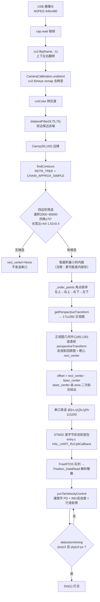

# 视觉项目复盘报告 — ShiJiang-hub/2025-E-

> 分析对象：https://github.com/ShiJiang-hub/2025-E- （2025 全国大学生电子设计竞赛 E 题「简易自行瞄准装置」，作者自述获国一）
> 分析日期：2026-10-05　分析者角色：计算机视觉算法 / 代码架构 / 实验复盘
> 证据等级：**A**=代码直接证明｜**B**=配置/注释支持｜**C**=合理推断｜**D**=需外部信息
> 标注约定：全文用【事实】【推测】【待验证】区分，并给出证据等级。

---

## 0. 分析计划（已执行）

本仓库是**嵌入式竞赛项目**，不是深度学习工程。因此先做全仓扫描确认「视觉」到底落在哪一层，再决定模板的哪些小节适用：

1. 仓库扫描 → 确认视觉代码位置（已完成）。
2. 判断技术范式 → **结论：传统几何视觉（OpenCV），无任何神经网络、无数据集、无训练/权重**。
3. 对用户模板中 **数据集 / DataLoader / Backbone-Neck-Head / 损失函数 / 优化器 / NMS / 量化部署** 等小节：**判定为不适用（N/A）**，改为本项目真实存在的对应物（几何算法模块、串口协议、云台控制环）。
4. 重点分析：识别逻辑、数据流闭环、"为什么有效"、风险与可迁移性。

> ⚠️ **重要前置结论**：用户的模板默认为「目标检测/识别深度学习项目」。但本项目**没有任何模型、没有训练、没有标注数据**。它"识别效果好"的归因**完全不在数据/模型/损失层面**，而在**任务本身简单 + 几何算法选型正确 + 软硬件闭环紧耦合**。下文会逐条给出证据链，并明确哪些小节为空。

---

## 1. 结论摘要

1. **这是什么**：电赛 E 题「简易自行瞄准装置」的硬件+软件开源实现。由**循迹小车 + 二维云台激光瞄准**两大部分组成；视觉只服务于"找到靶心、把激光打上去"。
2. **视觉在哪**：**树莓派端 Python + OpenCV**，共 3 个文件（`c1.py` 主程序、`jiaozheng.py` 标定矫正、`calibration_result.yaml` 标定参数）。STM32H750 侧只接收视觉结果做云台 PID。【事实 A】
3. **核心栈**：`OpenCV(cv2)` + `NumPy` + `pyserial` + `PyYAML`；相机为**鱼眼广角**（`cv2.fisheye` 模型）。**无 PyTorch / TensorFlow / ONNX / NCNN / 任何权重文件**。【事实 A】
4. **视觉范式**：**传统几何视觉**。Canny 边缘 → 找轮廓 → 四边形筛选（面积 / 直角 / A4 长宽比）→ **透视变换求正视图中心再反投影**得靶心。不是检测网络，也**不需要训练**。【事实 A】
5. **"激光中心"不是识别出来的**：而是用**靶纸面积的二次多项式拟合**出激光在画面上的落点，用于补偿相机与激光笔的光轴视差。这是本项目最"工程化"也最"不通用"的一处设计。【事实 A】
6. **效果指标口径**：README 给出的是**物理命中误差**（静止 ≤1.5cm、随机朝向 ≤1.8cm、行驶中 ≤8cm），**不是数据集 mAP/IoU 之类**。因此"效果好"是**竞赛评审口径**，无留出集、无消融、无量化评测协议。【事实 B / 证据等级 C】
7. **效果好的真正主因**：① 目标是**高对比度 A4 黑框**、光照受控、距离近 —— 任务本身对几何法极其友好；② **透视变换 + 中心反投影**比取质心/外接框中心更抗透视形变；③ **取最小内框**正确处理了"回"字形多层框；④ **鱼眼去畸变**消除了广角镜头的直线弯曲；⑤ 视觉只管"像素偏移"，角度/惯性补偿放在 STM32 端闭环 —— 分工干净。
8. **必须点破的一点**：`laser_center` 的经验拟合式（含 `-1.928e-09·area²`）与 y 恒为 `251` 等常数，本质是**针对该套硬件（特定相机/镜头/激光安装位）的标定结果**，泛化性弱；换了器材必须重标。【事实 A，风险项】
9. **可复现性**：视觉侧**无需 GPU、无模型**，只要树莓派 + 摄像头 + 对应标定文件即可跑；但**标定文件 `calibration_result.yaml` 与物理相机绑定**，直接复用他人标定会失准。【事实 A】
10. **代码不完整**：README 明确提到 `carTi`（MSPM0G3507 循迹小车）程序，但**仓库中只有 `carNoTi`（STM32H750 云台）**，`carTi` 缺失；标定采集脚本（生成 yaml 的棋盘格标定程序）也未上传。【事实 A / 待验证】

---

## 2. 仓库地图与运行入口

### 2.1 顶层结构

```
2025-E-/
├── README.md / Readme.md
├── 硬件设计/                      # .epro 原理图 + SolidWorks 3D 打印件
│   ├── ProPrj_*.epro
│   └── 打印件3D模型/*.SLDPRT
└── 软件设计/
    ├── 小车程序/
    │   ├── Readme.md              # 说明 carNoTi=STM32H750云台, carTi=MSPM0循迹(未上传)
    │   └── carNoTi/               # STM32H750VBTX 工程 (CMake + HAL + FreeRTOS)
    │       ├── Core/              # CubeMX 生成的 HAL 初始化
    │       ├── Drivers/           # HAL + CMSIS
    │       ├── Middlewares/.../FreeRTOS
    │       └── SYS/               # ★ 用户业务代码
    │           ├── C/ entry.c control.c dataRec.c can_motor_control.c yunTaiQuestion.c
    │           └── H/ *.h
    ├── 树莓派程序/                 # ★★★ 视觉代码全部在此
    │   ├── c1.py                  # 主视觉程序 (12.8 KB)
    │   ├── jiaozheng.py           # 鱼眼畸变矫正类 (3.2 KB)
    │   └── calibration_result.yaml# 相机内参+畸变系数
    └── 无线程序/
        ├── ESPNow_Car.c / ESPNow_Pi.c / ESPNow_computer.c   # ESPNow 组网
        └── dianSai2025(中控台)/    # ESP32-S3 + LVGL 调参中控台
```

### 2.2 视觉运行入口

| 项 | 内容 | 证据 |
|----|------|------|
| 入口文件 | `软件设计/树莓派程序/c1.py`，`if __name__ == "__main__": main()` | c1.py L308-309 【事实 A】 |
| 运行方式 | 树莓派上 `python3 c1.py`（需接 USB 摄像头 + 串口设备） | 【推测 C】 |
| 配置方式 | **硬编码常量**（端口/阈值/系数直接写在文件头与类里），唯一外置配置是标定文件 | c1.py L8-35 【事实 A】 |
| 标定文件路径 | `/home/pi/Desktop/last/calibration_result.yaml`（硬编码绝对路径） | c1.py L8 【事实 A】 |
| 串口 | `/dev/ttyUSB0`, 115200, timeout=1 | c1.py L17-19 【事实 A】 |

---

## 3. 技术栈总览表

> 用户要求的分类中，**"数据标注 / 训练管理 / 加速 / ONNX/TensorRT" 全部为空**（本项目无训练、无模型导出）。下表如实标注。

| 类别 | 技术/库 | 版本线索 | 项目中的角色 | 对"识别效果"的可能贡献 | 证据 |
|------|---------|----------|--------------|------------------------|------|
| 语言（视觉） | Python 3 | 无版本钉死 | 树莓派视觉主程序 | — | A |
| 语言（控制） | C (C11) | `CMakeLists.txt` | STM32/ESP 固件 | 决定闭环实时性 | A |
| 框架（DL） | **无** | — | 项目不使用任何深度学习框架 | **本项目的"效果好"与模型无关** | A（缺失证据） |
| 视觉库 | **OpenCV (cv2)** | 引自 `fisheye` API → OpenCV ≥3.0 | 去畸变、滤波、边缘、轮廓、透视变换 | 几何识别核心 | A |
| 数值库 | NumPy | — | 角点/向量/排序运算 | 支撑几何筛选 | A |
| 相机标定 | `cv2.fisheye`（鱼眼模型） | 4 畸变系数模型 | 广角镜头去畸变 | 消除畸变导致的直线弯曲→提升角点精度 | A |
| 数据标注 | **无** | — | 无标注、无数据集 | — | A（缺失） |
| 训练管理 | **无** | — | 无训练循环、无权重 | — | A（缺失） |
| 推理部署 | 原生 Python 循环 | — | 树莓派本地实时处理 | 轻量、无依赖 | A |
| 加速 | **无显式加速** | — | 无 TensorRT/OpenVINO/NCNN/量化 | 靠任务简单本身够快 | A（缺失） |
| 通信 | **pyserial** | — | 串口发靶心/激光坐标给 STM32 | 打通"识别→控制"闭环 | A |
| 配置解析 | **PyYAML** | — | 读相机内参/畸变 | 标定与代码解耦 | A |
| 可视化/调试 | `cv2.imshow` | — | "Inner Rectangle Detector" + "Warped View" 两窗口 | 调试期用，比赛需无头运行 | A |
| 协处理器通信 | CAN / FDCAN + 张大头步进驱动 | `can_motor_control.c` | STM32 控制云台步进电机 | 影响实际命中精度 | A |
| 无线调试 | ESPNow（MAC 层）+ LVGL | — | 中控台远程调参 | 提升调参效率，间接提升效果 | B |

---

## 4. 数据流与管线（推理管线 = 全流程）

> **本节替代模板中的"训练管线"**。本项目**只有推理管线**，无训练管线。下图为从摄像头到打点的完整数据流（Mermaid）。



**闭环要点**：视觉端只输出**像素级偏差**，不在视觉端做角度解算；角度/惯性/行进补偿全部下沉到 STM32。视觉与控制的**解耦**是本设计稳定性的关键。【事实 A】

---

## 5. 算法与关键模块（替代"模型结构"）

> **本项目无 Backbone/Neck/Head/注意力/锚框/损失函数**——它是几何算法，不是神经网络。以下按真实模块说明「作用 / 输入输出 / 为什么这样设计」。

### 5.1 `class A4RectangleDetector`（c1.py L22-206）

| 方法 | 作用 | 输入 → 输出 | 为什么这样设计（效果归因） |
|------|------|-------------|---------------------------|
| `_order_points` (L37-45) | 把 4 角点按（左上/右上/右下/左下）排序 | 4×2 点 → 有序 4×2 | 用 `sum` 与 `diff` 极值定位角点，保证后续透视变换的**源点与目标点一一对应**；排序错则 warp 会翻折。 |
| `_is_rectangle` (L47-76) | 判断 4 边形是否"接近矩形" | 多边形 → bool | 用**向量点积求每个内角 cos**，要求四角均 ≥ `angle_threshold=70°`。排除三角形/不规则四边形。 |
| `_check_aspect_ratio` (L78-93) | 判断长宽比接近 A4 | 4 角点 → bool | A4 比例 `26.0/17.1=1.520`，容差 `±0.4`（即 [0.91, 2.13]）。**用形状先验替代模板匹配**。 |
| `_calculate_pixel_ratio` (L95-103) | 计算像素/厘米比例 | 4 角点 → float | 【事实 A】**该值被计算但无下游消费者**（只存 `self.pixels_per_cm`）→ **疑似预留的死代码**，本流程不用于测距。 |
| `_perspective_transform` (L105-126) | 生成 A4 正视图并保存逆矩阵 | 4 角点 → 正视图中心 | warp 到 `171×260`（与 A4 等比），**把任意姿态的靶纸拉正**，使"中心"定义与视角无关。 |
| `_get_original_center` (L128-136) | 正视图中心反投影回原图 | — → 原图靶心像素 | 中心只在正视图里取（简单、稳定），再**逆映射**回原图坐标。这是本题最巧妙的一步。 |
| `detect_and_draw` (L138-206) | 单帧主流程 | frame → (result, center) | 见 §4；L177-180 的**"取最小面积"**策略解决多层框取内框。 |

### 5.2 `class CameraCalibration`（jiaozheng.py L14-57）

| 项 | 说明 | 证据 |
|----|------|------|
| 标定模型 | **鱼眼（fisheye）模型**，`cv2.fisheye.estimateNewCameraMatrixForUndistortRectify` + `initUndistortRectifyMap` | jiaozheng.py L22-27 【事实 A】 |
| 去畸变 | `cv2.remap(frame, map1, map2, INTER_LINEAR)` 预计算映射表 | L43-49 【事实 A】 |
| 参数来源 | 从 YAML 读 `DIM/K/D`，`D` 重塑为 `(-1,1)` | L29-41 【事实 A】 |
| `balance=0.0` | 去畸变不保留黑边视野 | L15 【事实 A】 |

**为什么用鱼眼模型**：硬件用的是广角/鱼眼免驱摄像头（README 硬件清单：「亚博 USB 免驱摄像头」）。广角镜头畸变大，**不去畸变则"矩形"在画面里是弯的**，Canny + 四边形筛选会系统性失效。→ 去畸变是"识别能成立"的前置条件。【事实 A + 推测 C】

### 5.3 标定文件 `calibration_result.yaml`

```yaml
DIM: [640, 480]
K: [[468.136, 0, 336.082],
    [0, 467.814, 228.151],
    [0, 0, 1]]
D: [k1=-0.05900, k2=-0.05094, k3=0.02757, k4=-0.00227]
```
- 分辨率 640×480；cx=336 略偏离 320、cy=228 略偏离 240 → **主点偏移正常**（装配误差）。【事实 A】
- 畸变系数 k1、k2 为负 → **桶形畸变**，符合广角镜头特征。【事实 A】

### 5.4 "激光中心"模型（**非识别，是拟合**）— c1.py L245-249

```python
if detector.detected_area == 0:
    laser_center = (330, 251)                     # 固定缺省
else:
    width_center = int(area*area*(-1.928e-09) + area*0.0004398 + 318.7)
    laser_center = (width_center, 251)            # y 恒 251
```
- **作用**：估算"激光光斑本应落在画面的哪个像素"，从而算出靶心相对激光的偏移。
- **机制**：摄像头与激光笔**不同轴**，目标远近变化时激光落点会横向漂移；用"靶纸面积"（≈距离代理量）做**二次拟合**补偿视差。
- **为什么这么做**：直接检测激光光斑需要处理强光/过曝/反光，鲁棒性差；作者选择"**标定一次、公式外推**"。【推测 C】
- **代价**：公式系数与 y=251 是**该套硬件的拟合结果**，换相机/换安装位即失效。【事实 A，风险】

### 5.5 与 STM32 的接口（消费端，非视觉但决定效果）

| 文件/函数 | 作用 | 证据 |
|-----------|------|------|
| `entry.c` `HAL_UART_RxCpltCallback` (L109) | 逐字节状态机：`@`→数据→`%`，经 `xQueueSendFromISR` 投递 | L109-180 【事实 A】 |
| `dataRec.c` `Position_DataRead` (L81) | 可变参数解析，**仅解析整数**，分隔符 `, 空格 ]`（`[`、`;` 被忽略） | L81-110 【事实 A】 |
| `control.c` `yunTaiVelocityControl` (L42) | 速度环 PD，误差 = `target - now` | L42-61 【事实 A】 |
| `control.c` `detectionAiming` (L62) | `|Δx|≤3 && |Δy|≤3` 判定瞄准完成 | L62-67 【事实 A】 |
| `control.c` `PID_Init` (L69) | Kp=0.532, Ki=0, Kd=1.49, limit=3000（y 轴取负） | L69-79 【事实 A】 |
| `control.c` L48-49 | 叠加 `myIMU.w[2]*2.4f`（反自旋）+ `SpeedInverse*95.7f`（行进前馈） | L48-49 【事实 A】 |
| `yunTaiQuestion.c` `aimToDot` (L16) | goHome → 速度环瞄准 → 命中 → `Dot(1)` 打点 | L16-36 【事实 A】 |

---

## 6. 训练策略 / 推理策略 / 后处理 / 部署

> **训练策略：无**。本项目不含预训练、迁移学习、优化器、LR 调度、warmup、EMA、混合精度、分布式、梯度裁剪、正则、早停、冻结——**以上全部 N/A**【事实 A，缺失证据】。

### 6.1 推理策略（真实存在）

| 环节 | 做法 | 证据 |
|------|------|------|
| 采集 | `VideoCapture(0)` + MJPG + 请求 60fps | c1.py L211-213 【事实 A】 |
| 预处理 | `flip(-1)` → 鱼眼去畸变 → 灰度 → 双边滤波 | L238-242 【事实 A】 |
| 边缘 | Canny 双阈值 50/150 | L143 【事实 A】 |
| 轮廓 | `RETR_TREE`（保留层级，便于选内框） | L146 【事实 A】 |
| 后处理 | 面积/直角/长宽比三重门槛 + **取最小内框** | L156-180 【事实 A】 |
| 输出 | 仅当检测到才发串口；`@[..];[..]%` | L286-289 【事实 A】 |

### 6.2 后处理细节（模板中"置信度阈值/NMS/TTA"的对应物）

- **置信度阈值 → 几何阈值**：面积 `[2000,80000]`、角度 `≥70°`、长宽比 `1.52±0.4`。**没有概率阈值**（非学习模型）。
- **NMS / Soft-NMS / TTA / 多尺度 / 滑窗 → 均无**。多候选通过"**取最小面积**"这一先验直接裁决。【事实 A】
- **跟踪平滑 → 无**。检测失败直接 `last_center=None`，**不做卡尔曼/光流外推**（L196-200）→ 运动中丢帧会瞬断目标。【事实 A，风险】
- **量化 / ONNX / TensorRT / OpenVINO → 均无**。

### 6.3 部署形态

- 树莓派本地 Python 进程，依赖 `cv2 / numpy / serial / yaml`。
- 相机通过 USB；STM32 与树莓派之间经串口（README 另述经 ESP01s/ESPNow 中转）。
- 调试用 `cv2.imshow` 两个窗口（L283、L296），退出键 `q`（L299）→ **比赛时需无头运行（注释掉）**。【事实 A】

---

## 7. "识别效果好"的归因矩阵

> 因果链格式：**效果来源 → 具体机制 → 对应代码/配置 → 证据强度 → 可迁移性 → 风险**

| # | 效果来源 | 具体机制 | 对应代码/配置 | 证据强度 | 可迁移性 | 风险 |
|---|----------|----------|---------------|----------|----------|------|
| 1 | **任务本身简单** | 目标是高对比度 A4 白底黑框、光照受控、近距离 → 边缘清晰 | 整套流程假设此前提 | **C**（任务定性，无量化） | 低（强依赖场景） | 换个花哨目标即失效 |
| 2 | **去畸变前置** | 鱼眼广角畸变会让"矩形"弯曲，去畸变后角点才准 | `jiaozheng.py` L22-49 | **A** | 高 | 标定文件与相机绑定 |
| 3 | **中心定义抗透视** | 透视变换→正视图取中心→逆映射，中心只依赖 4 角点 | `_perspective_transform`/`_get_original_center` L105-136 | **A** | **高（最值得借鉴）** | 角点检测误差直接传导 |
| 4 | **多层框取内框** | "取最小面积合格矩形"命中内框 | L177-180 | **A** | 高 | 若画面出现更小杂矩形会误选 |
| 5 | **视差补偿** | 用面积二次拟合激光落点，抵消非同轴误差 | L245-249 | **A**（公式存在）/**C**（有效性） | **低（硬件绑定）** | 换器件即失效；不是实时检测激光 |
| 6 | **视觉-控制解耦** | 视觉只给像素偏差；角度/惯性补偿在 STM32 | `control.c` L48-49 | **A** | 高 | 串口时延/丢包无补偿 |
| 7 | **反自旋 + 行进前馈** | IMU 角速度反向补偿 + 行进角速度前馈，抵消小车运动扰动 | `control.c` L48-49 | **A** | 高 | 系数 2.4 / 95.7 需重调 |
| 8 | **瞄准判定简单化** | 偏差 ≤3px 即打点，避免过度收敛耗时 | `detectionAiming` L62-67 | **A** | 中 | 3px 对应实际 cm 随距离变化 |
| 9 | **调参效率** | ESP32+LVGL 中控台远程调 PID，缩短整定时间 | 无线程序/中控台 | **B** | 中 | 与识别算法本身无关，属工程效率 |

**归因结论（直白版）**：
- 效果好**主要来自 ②③④⑥⑦（几何算法与闭环工程）**，而不是任何"学习/数据"因素。
- ① 是"效果能这么好"的**前提条件**——A4 靶纸是几何法的"送分题"。
- ⑨ 只影响"人调得快不快"，不影响算法上限。
- 不存在数据泄漏问题（根本没有数据集）；但存在**硬件/场地强绑定的"过拟合式标定"**（⑤）。

---

## 8. 复现清单

### 8.1 最小运行命令（视觉侧）

```bash
# 依赖
pip3 install opencv-python numpy pyserial pyyaml

# 1) 把标定文件放到代码里写死的路径（或改 c1.py L8）
#    /home/pi/Desktop/last/calibration_result.yaml
# 2) 确认摄像头为 /dev/video0，串口为 /dev/ttyUSB0（否则改 L17）
python3 c1.py
# 调试窗口：Inner Rectangle Detector / Warped View，按 q 退出
```

### 8.2 关键配置（需按自己硬件改）

| 配置 | 位置 | 默认值 | 说明 |
|------|------|--------|------|
| 标定文件路径 | c1.py L8 | `/home/pi/Desktop/last/calibration_result.yaml` | 必须与相机/分辨率匹配 |
| A4 尺寸 | L11-12 | 17.1 / 26.0 cm | 换靶纸尺寸要改 |
| 长宽比容差 | L14 | 0.4 | 偏宽松 |
| 面积阈值 | L24-25 | 2000 / 80000 | 随距离改 |
| 直角阈值 | L27 | 70° | 偏宽松 |
| 正视图尺寸 | L34-35 | 171×260 | 与 A4 等比 |
| 串口 | L17-18 | /dev/ttyUSB0 @115200 | — |
| 激光中心拟合 | L245-249 | 二次式 + y=251 | **必须重标定** |

### 8.3 预期指标（README 自述，非本报告实测）

| 场景 | 指标 |
|------|------|
| 静止打靶 | ≤2s，误差 ≤1.5cm |
| 云台随机朝向 | ≤4s，误差 ≤1.8cm |
| 行驶中连续瞄准 2 圈 | 最大误差 ≤8cm |
| 循迹 | ≥2cm 黑线，每圈 <20s |

### 8.4 建议消融实验（原作者未做，本报告建议）

1. **去畸变 on/off** → 量化角点误差与命中误差，验证 §7-②。
2. **中心策略 A/B**：透视反投影中心 vs 外接框几何中心 vs 轮廓质心。
3. **内框选择策略**：取最小面积 vs 取最大面积 vs 按层级选第 N 层。
4. **阈值敏感性**：直角阈值 70°/80°/85°，长宽比容差 0.4/0.2/0.1 → 误检率 vs 漏检率曲线。
5. **"激光中心"替代方案**：用颜色/亮度阈值实时检测激光光斑，与经验公式对比命中误差与鲁棒性。
6. **丢帧处理**：加入卡尔曼/上一帧外推，对照"运动中最大误差 ≤8cm"能否下降。
7. **帧率实测**：确认树莓派上实际 FPS（代码只显示未记录）。

---

## 9. 风险、局限与待补充信息

### 9.1 算法与代码风险

| 风险 | 说明 | 证据 |
|------|------|------|
| **阈值过宽易误检** | 直角 ≥70°、长宽比 [0.91,2.13] 都很宽，桌面/纸箱/地砖缝可能被误判为靶纸 | c1.py L27/L78-93 【事实 A】 |
| **激光中心为拟合非检测** | 公式 + y 恒定，换硬件即失效；也无法处理激光被打偏/遮挡 | L245-249 【事实 A】 |
| **无跟踪外推** | 检测失败即 `None`，运动中丢帧瞬断 | L196-200 【事实 A】 |
| **串口无校验/无重发/阻塞写** | `ser.write` 阻塞，`@..%` 无 CRC，丢包无恢复 | L286-293 【事实 A】 |
| **解析不支持小数** | `Position_DataRead` 只累加整数，`,`/空格/`]` 分隔 | dataRec.c L81-110 【事实 A】 |
| **死代码** | `_calculate_pixel_ratio`/`pixels_per_cm` 算了不用 | c1.py L95-103/L191 【事实 A】 |
| **调试窗口未移除** | `cv2.imshow` 依赖 GUI，无头环境会报错 | L283/L296 【事实 A】 |
| **硬编码绝对路径** | `/home/pi/Desktop/last/...` | L8 【事实 A】 |
| **无头/无日志/无指标记录** | 无结构化日志、无 FPS 落盘、无测量数据 | 全文 【事实 A】 |

### 9.2 评测协议风险（重点）

- README 的"效果"是**物理命中误差**，是**竞赛现场一次性成绩**，**非留出集统计**。
- **无基线对比、无消融、无重复实验方差** → 无法判定各模块的边际贡献。
- **存在"测试集调参"嫌疑**：阈值与激光拟合系数很可能是**在比赛场地对着靶纸实测调出**的（这是竞赛常规操作，但严格讲属于对特定场景/硬件的过拟合）。【推测 C】
- **无可复现评测脚本**：没有提供生成指标的程序。

### 9.3 待补充信息（见 §10）

---

## 10. 需要你补充的文件/片段（代码不完整）

以下内容仓库中**缺失或未上传**，若要复现/深入复盘需补充：

| 缺失项 | 影响 | 优先级 |
|--------|------|--------|
| **相机标定采集脚本**（生成 `calibration_result.yaml` 的棋盘格标定程序） | 无法为你的相机重新标定 → 去畸变失效 | 高 |
| **`carTi`（MSPM0G3507 循迹程序）** | README 提及但仓库只有 `carNoTi`；循迹逻辑无法复盘 | 中 |
| **`Core/Src/freertos.c` + `main.c` 的完整任务创建顺序** | 只看到 `entry.c` 的 `setupTask`；任务优先级/栈深全貌待核实 | 中 |
| **`can_motor_control.h` / `dataRec.h` / `control.h`** | 数据结构（`Drap_t`/`Position_t`/`PID_Controller`）定义未取 | 中 |
| **ESPNow 三个 `.c` 的实际中转逻辑** | 树莓派→STM32 的链路是直连串口还是 ESP 中转，README 与 c1.py 不一致 | 中 |
| **演示视频/实测数据**（b23.tv/6O1KHSb 内容） | 无法核对真实 FPS 与命中误差 | 低 |
| **`pc_camera`/`undistort` 的图像样本**（畸变校正前后截图） | 无法定量验证去畸变效果 | 低 |

> 上述文件我已能通过 GitHub API 继续拉取（如 `.h` 头文件），如需请告知。

---

## 附：证据索引（文件 → 关键行）

| 文件 | 关键行 | 内容 |
|------|--------|------|
| `树莓派程序/c1.py` | L8 | 标定文件绝对路径 |
| | L11-14 | A4 尺寸与比例容差 |
| | L17-19 | 串口配置 |
| | L24-27 | 面积/近似/角度阈值 |
| | L34-35 | 正视图尺寸 171×260 |
| | L37-136 | 角点排序/矩形判定/长宽比/透视/反投影 |
| | L138-206 | 单帧主流程 |
| | L177-180 | 取最小面积内框 |
| | L211-213 | 摄像头 MJPG 60fps |
| | L238-249 | 翻转/去畸变/激光中心拟合 |
| | L286-289 | 串口发送协议 |
| `树莓派程序/jiaozheng.py` | L14-57 | 鱼眼矫正类 |
| `树莓派程序/calibration_result.yaml` | L1-10 | K / D / DIM |
| `小车程序/carNoTi/SYS/C/entry.c` | L109-180 | 串口收包状态机 |
| `小车程序/carNoTi/SYS/C/dataRec.c` | L29-76 | 队列消费与分支 |
| | L81-110 | 整数解析 |
| `小车程序/carNoTi/SYS/C/control.c` | L42-61 | 云台速度环 PD |
| | L48-49 | IMU 反自旋 + 行进前馈 |
| | L62-67 | 瞄准判定 |
| | L69-79 | PID 参数 |
| `小车程序/carNoTi/SYS/C/yunTaiQuestion.c` | L16-51 | 瞄准打点状态机 |
